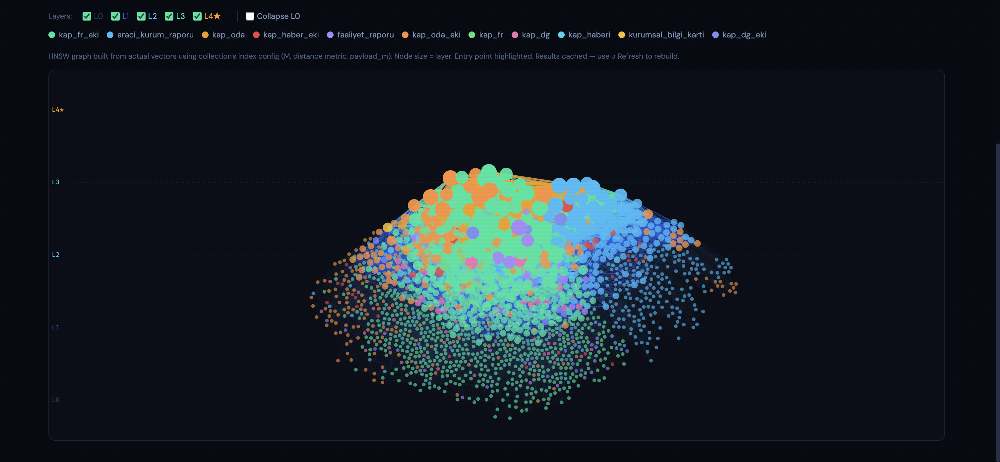

# Qdrant Monitor

A local dashboard for monitoring, browsing, and visualizing Qdrant vector database collections. Built with FastAPI, HTMX, D3.js, and Plotly — no build step required.


**HNSW Graph** — real index structure, layer-stratified, colored by payload field:



## Features

### Collections dashboard
- Overview of all collections — point counts, indexed vectors, indexing %, segment count, shard count
- Status badges (green/yellow/red)
- Vector config chips (name, dimensions, distance metric, sparse)

### Collection detail
- Full config inspection: HNSW params (M, ef_construct, payload_m), optimizer, WAL, quantization
- Payload schema with indexed field types
- Shard and segment breakdown

### Browse & search
- **Browse** — paginated point table with expandable JSON payload
- **By ID** — fetch any point by integer or UUID
- **By Text** — substring search across any payload field
- **Similar** — find nearest neighbors by Point ID using `query_points` API; configurable limit and named vector

### Vector Space visualization

#### HNSW Graph
Real graph built from actual vectors using the collection's index config (M, distance, payload_m):

- Nodes assigned HNSW layers probabilistically (matching Qdrant's `ml = 1/ln(M)` formula)
- **Layer stratification** — L0 at bottom, entry-point layer at top; dashed band lines per layer
- **Pyramid X constraint** — higher layers cluster narrower horizontally
- **Node size scales with layer** — entry point has white ring
- **Layer toggle checkboxes** — show/hide any layer independently
- **Collapse L0** — shrink dense base-layer nodes to dots to reveal higher-layer structure
- **Color by payload field** — color nodes by any keyword/string payload field
- **Node click → similar points** — click any node to fetch its nearest neighbors via Qdrant's `query_points` API
- **payload_m support** — when `payload_m > 0`, builds per-keyword-value sub-HNSWs matching Qdrant's actual index structure (disconnected subgraphs per keyword value)
- Sample up to 2000 points; results cached, refresh on demand
- Zoom, pan, drag nodes

#### PCA Projection
- 2D scatter of actual vectors via PCA (numpy SVD, no sklearn)
- Color by any payload field
- **Click a point** → fetch similar vectors via `query_points`, shown inline below the plot
- Named vector support for multi-vector collections

## Prerequisites

- Python 3.12+
- [uv](https://docs.astral.sh/uv/) package manager
- A running Qdrant instance (default: `localhost:6333`)

## Setup

```bash
git clone https://github.com/tunahanyazar0/QdrantMonitor
cd QdrantMonitor

uv sync
uv run qdrant-monitor
```

The app starts at **http://localhost:11000**.

Enter your Qdrant host and port in the top bar and click **Connect** (defaults to `localhost:6333`).

## Running Qdrant locally

```bash
docker run -p 6333:6333 -p 6334:6334 qdrant/qdrant:latest
```

## Tech Stack

| Layer | Libraries |
|-------|-----------|
| Backend | FastAPI, Jinja2, qdrant-client ≥ 1.17 |
| Frontend | Tailwind CSS (CDN), HTMX, D3.js v7, Plotly.js |
| Visualization | D3 force simulation, numpy SVD (PCA) |
| Package manager | uv |
